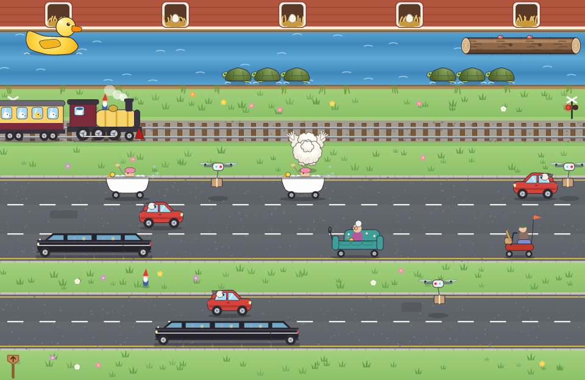
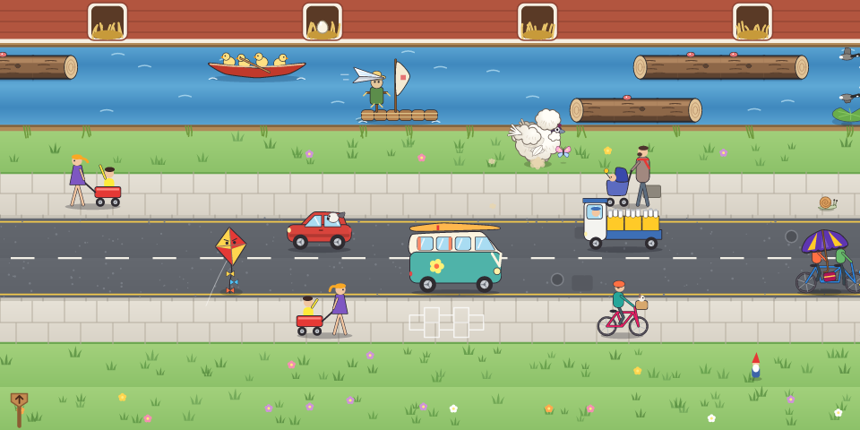
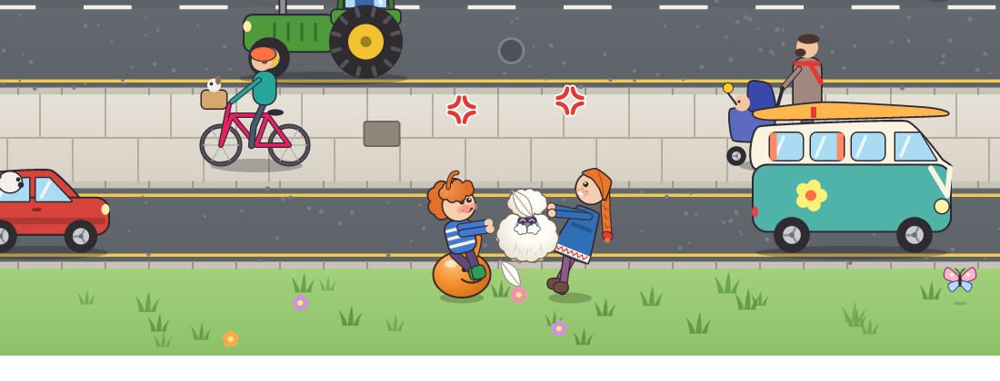
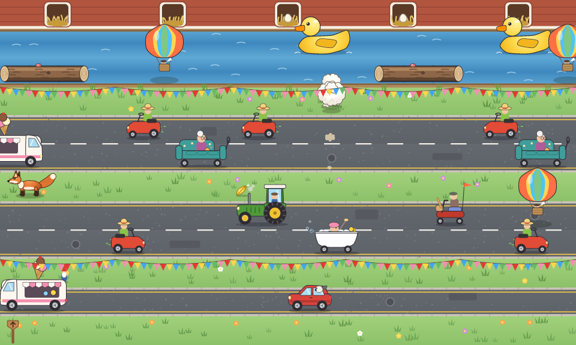

# Silkie Sprint

*Hop the traffic. Ride the river. Fly when you must.*

Silkie Sprint is a lane-crossing arcade game for the terminal, written in
Rust, set in the same backyard universe as
[Silkie Scramble](../silkie-scramble). You are a Silkie hen, a pom-pom of
white feathers, and across a road, a railway and a river stands the
henhouse with its row of empty nest boxes. Get across, hop up into an empty
box, and lay an egg. Fill every box and the eggs hatch.

Unlike most Silkies, this one can fly. Briefly. A full wings meter lasts
about a second, it refills slowly while she is on the ground, and it is not
topped up between crossings, so a flight spent now is missing later. The sky
has hazards of its own.



It runs in [kitty](https://sw.kovidgoyal.net/kitty/) and in
[Silkie](https://silkie.goblinreactor.com/), a fork of kitty with extra
graphics, input and timing protocols. kitty is fully supported; Silkie makes
it better (see [Terminal support](#terminal-support)).

## Playing

Each crossing starts on the verge at the bottom. Every hop to a row you have
not reached yet this crossing scores 10. Reaching a nest scores 50, plus 20
for every second left on the crossing's clock. Fill the last box and the
eggs hatch, for a 1000-point bonus. Run out of time and the hen sits down
for a nap, which costs a life. An extra life comes every 10,000 points.

* **Roads**: whatever is on the road runs you over. Hatchbacks with a
  sheepdog at the window, tractors, ice-cream vans with a giant cone on the
  roof, motorised sofas driven by knitting grannies, mobility scooters,
  bathtub racers, ride-on mowers, a double-decker bus full of sheep, camper
  vans with a surfboard on the roof, milk floats, tandems, a clown on a
  unicycle, and stretch limousines of any length.
* **Sidewalks** are no safer: cyclists with a terrier in the basket, dads
  pushing prams, and girls towing their little brothers in red wagons will
  all knock a hen flat.
* **Rivers**: Silkie feathers are not waterproof. Ride logs, turtles, giant
  rubber ducks, inflatable flamingos, swan pedalos, a raft captained by a
  scarecrow, canoes full of ducklings, rubber rings, lily pads and a
  drifting picnic table. Some turtles dive: bubbles mean they are about to.
  Ride off the edge of the field and you are swept away.
* **The railway**: when the crossing lights flash, the Custard Express is
  coming, crewed by hens on a day out.
* **Verges** are safe, except where a fox prowls. A fox that sees you
  standing about freezes with a "!" and then runs at you. It cannot keep up
  with a hen who keeps hopping.



### Bugs

Bugs turn up all over the field, one every second or so, and a hen is
always peckish. Six kinds live
on the ground and are pecked up on foot: snails (40), ladybirds (50),
caterpillars (75), worms (80, and they soon go back underground), beetles
(100, in quick dashes) and grasshoppers (150), which leap away when you get
close and need a moment to recover before they can leap again: chase them
down. Two fly, and are only caught in the air: butterflies over the land
(200) and dragonflies darting over the river (250).

Catch bugs within three seconds of each other for a combo: the second is
worth double, the third triple, and so on. A bug that wanders onto a road
or the railway gets splatted by whatever comes along; on a sidewalk the
bicycles and prams always miss.

### Flight

Press **Space** to take off and Space again to come down. Up in the air the
hen clears traffic and water, and each arrow key is a fluttering glide (a
little slower than a hop). The wings meter drains while she flies. When it
empties she comes down wherever she is, river included. It starts to refill
a moment after she lands, slowly (an empty meter takes 16 to 22 seconds on
the ground to fill), and she needs a quarter of it to take off again. The
meter is not refilled when she lays an egg or loses a life: whatever is
left carries over to the next crossing, and only a new level starts full. A
golden feather fills it at once.

The sky has its own traffic, which only troubles a flying hen: kites (they
do not like being flown into), hot-air balloons, parcel drones, skeins of
geese, a blimp, paper aeroplanes and a runaway umbrella. You can see their
shadows on the ground. Bunting strung across a verge means no flying there,
so walk under it.

### The hawk

The hawk from Silkie Scramble hunts every level. Two things draw it: a hen
in the air, and a hen standing about on open grass. Its shadow slides in
over her, and about a second and a half later it stoops. If it found you
flying, land: a hen on the ground is beneath its notice. If it found you
loitering, hop out from under the shadow, which settles where it saw you.
Bunting overhead is cover.

### Loki and Skaði



Two children want nothing more than to cuddle a Silkie, and they are on
every level, always somewhere on the field. **Loki** is small, with a shock
of orange hair, and bounces about on an orange space hopper. **Skaði** is
his big sister, with long orange hair in braids and a blue dress, and she
runs. Every so often one of them decides it is cuddle time and chases the
hen wherever she goes. The traffic passes them by and they cross the river
as if it were not there: cartoon physics. Both are slower than a hopping
hen (Skaði a little quicker than Loki), neither can reach a flying one, and
after a while they get bored and go back to playing.

A child who catches the hen on the ground picks her up and pets her. The
crossing clock stops, because who could hurry a cuddle? Then they carry her
off and put her down somewhere random on the field: nearer the nests, or
further back. Neither is a monster: they only ever put her down where she
will be safe even if she does nothing at all. But Skaði is older and more
careful, and makes sure of four seconds; Loki only thinks two seconds
ahead. The game checks this exactly, by running a copy of itself forward
from the moment she would land; see [the technical notes](docs/TECHNICAL.md#the-children).

If one of them is holding the hen when the other comes near, it is a **tug
of war**. Skaði is older and wins more often (three times in five). The
winner runs off with the hen and puts her down, safe for as long as *they*
plan for; the loser stomps off to sulk.

### Stray chicks and treats

Now and then a lost chick drifts down the river on something it managed to
climb onto. Hop onto it and it rides home on the hen's back, for 200 more
points at the nest. Treats appear on the verges: corn (50) and golden
feathers (50, and a full wings meter).

### Levels

1. **Country Lane**: a little of everything, gently: two sidewalks, two
   roads, two rivers, things in the sky.
2. **Market Day**: busy streets and busier pavements, ice-cream vans, the
   bus, turtles, kites.
3. **The Millrace**: mostly water, diving turtles, a crosswind for fliers,
   and a fox on the towpath.
4. **The Bypass**: fast lanes, limousines, bathtub racers, drones, a blimp,
   and the Custard Express.
5. **Village Fete**: bunting you cannot fly through, hot-air balloons, a
   lawnmower race, a fox.
6. **Harvest Moon**: everything at once, in a gale.

Loki, Skaði and the hawk are on every level.

After Harvest Moon the countryside starts over, 15% quicker each time
round. Levels are plain text: see [the level format](assets/levels/README.md).



### Controls

| key | action |
|---|---|
| arrows, WASD (or HJKL) | hop (or glide); hold to keep hopping |
| Space, F, Enter | take off; again to land |
| click, pen or finger on the hen | take off or land |
| click, pen or finger anywhere else | hop that way |
| right click | take off or land |
| P, Esc | pause menu |
| F2 or ` | diagnostics panel |
| Ctrl+Z | suspend (the terminal is restored; `fg` resumes) |
| Ctrl+C | quit |

Any key during a level's opening card starts it at once.

## Terminal support

The game needs a terminal that implements the
[kitty graphics protocol](https://sw.kovidgoyal.net/kitty/graphics-protocol/).
Every feature is detected by asking the terminal at start-up, never by its
name or environment variables; `silkie-sprint --report` prints what your
terminal answered.

The rules, speeds, scoring and difficulty are identical everywhere. What
Silkie adds is presentation and input:

| | kitty | Silkie |
|---|---|---|
| Sprites | uploaded once, animated by moving placements; clipped to the field so traffic slides in from the edges | same |
| Field | rasterized by the game, uploaded once per level and size step | a retained vector image the terminal draws; an egg appearing or the crossing lights flashing is a patch of a few hundred bytes; a resize costs nothing |
| Title lettering | bitmap | vector, crisp at any size |
| Taps | mouse | mouse, pen or touchscreen |
| Frame pacing | timer | presentation reports from the terminal: draws exactly as fast as frames are shown |
| Input latency | normal | low-latency mode while playing |
| Menus | opaque panels | translucent panels over the field |
| Pointer | crosshair | a little white feather |
| Feedback | | trackpad haptics for taking off, nesting, bumps, cuddles, bugs and mishaps |
| Colour | sRGB | wide-gamut sprites on Display P3 screens; HDR glints on sparkles, stars and hearts |
| Display | | refresh rate, pixel scale and e-ink awareness from the display protocol |

Run with `--kitty-only` in Silkie to see the game as kitty shows it.

Inside tmux or screen the graphics protocol needs passthrough, which the game
does not attempt; run it directly in the terminal. Over SSH, images travel
inside the terminal stream (locally they go through temporary files), so the
first screen of a level takes a moment on a slow link; a banner says so.

## Installing

You need Rust (stable, 1.85 or newer) and Cargo.

```sh
cd silkie-sprint
cargo build --release
./target/release/silkie-sprint
```

or `cargo install --path .` to put `silkie-sprint` on your path. A big
window with a small font gives the field the most pixels.

### Options

```
--seed N            replay the same game (with the same inputs)
--level N           start on level N
--diagnostics       show the diagnostics panel (F2 toggles)
--kitty-only        use only what plain kitty offers
--no-vector, --no-latency, --no-frame-feedback, --no-haptics, --no-hdr
                    turn off individual Silkie features
--no-tempfile       send images inline even when files would work (as over SSH)
--record FILE       record your inputs; `silkie-sprint replay FILE` re-runs them
--report            print the terminal's capabilities and exit
--autoplay          let the built-in autopilot play
--log FILE          log to a file
```

Subcommands that need no terminal:

```sh
silkie-sprint headless                 # the autopilot plays every level, prints a table
silkie-sprint replay FILE              # re-runs a recording and checks the final state
silkie-sprint snapshot --level 2 out.png   # a picture of a moment of play
```

The `netsim` binary runs the game behind a simulated network link (delay and
bandwidth limit) to see how it behaves over a slow connection:

```sh
cargo run --release --bin netsim -- --delay-ms 40 --kbps 2000 -- \
    target/release/silkie-sprint --no-tempfile
```

High scores are kept in your platform's data directory (for example
`~/Library/Application Support/com.goblinreactor.silkie-sprint/` on macOS).

## Development

```sh
cargo test                       # unit and headless simulation tests
cargo clippy --all-targets
cargo run --release --example preview_sheet -- cars 96 cars.png
cargo run --release --example render_level -- 4 48 level.png
```

* [docs/TECHNICAL.md](docs/TECHNICAL.md): architecture, the simulation,
  Loki's safe landings, the autopilot, the renderers, and how each kitty
  and Silkie protocol is used.
* [assets/levels/README.md](assets/levels/README.md): the level format.
* [assets/PROVENANCE.md](assets/PROVENANCE.md): where the art and typeface
  come from.

The pictures in this README were made by `silkie-sprint snapshot`, which
composites the same sprites and scenery the terminal is sent.
